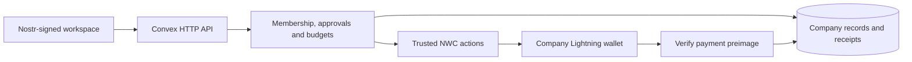

# GreyFinance

**Bitcoin treasury for teams.**

[Open GreyFinance](https://grey-finance.vercel.app) · [Source](https://github.com/greyw0rks/grey-payroll)

GreyFinance gives companies a shared workspace for Lightning payments, employee expenses, independent approvals and spending limits. Funds stay in the company's connected wallet. Verified payments become durable receipts with an audit trail.

The interface uses a forest and chalk palette, a clear financial grid, horizontal navigation and a touch-friendly bottom bar on phones. It supports keyboard navigation.

## What works

- Company workspaces with owner, finance, employee and viewer roles.
- Receive invoices with QR codes and wallet-verified settlement.
- Employee expense requests, independent approval and deliberate payment confirmation.
- Atomic company and employee spending limits, including reservations across month boundaries.
- Single payment attempts, uncertain-payment reconciliation and safe invoice expiry.
- Durable payment hashes, preimages, settlement times and source-wallet references.
- Nostr identity authentication and encrypted delegated NWC connections.
- Owner-controlled company deletion with exact-name confirmation and unresolved-payment guards.

## Run the complete local Lightning lab

Requires Linux x64, Node.js 22.12+ and pnpm. The script downloads checksum-pinned Bitcoin Core and LND, starts two private regtest wallets, opens a payment channel and launches GreyFinance.

```bash
./start.sh
```

Open **http://127.0.0.1:4402**, then choose **Open workspace**. Use the owner’s local wallet shortcut, submit a real regtest invoice, review it as Finance, then pay and inspect the receipt. Regtest coins have no monetary value. Sample rows are explicitly labeled and cannot execute payments.

## Production

The deployed interface uses **Convex** for durable company data, permissions, atomic payment states and receipts. NWC operations run in trusted server actions against the company's own wallet. Public production disables predictable local preview personas.

```bash
pnpm build:release
pnpm exec convex deploy
```

Deployment configuration and the final public URL are recorded in [deployment notes](docs/DEPLOYMENT.md).



## Validation and documentation

The local integration has executed a **150-sat company expense** and a **100-sat incoming payment** through two real LND regtest wallets using NWC. The employee was denied approval and direct company payment; Finance independently approved and paid. Both receiving wallets verified settlement, the payment preimages matched their hashes, and the app retained receipts and audit events. These are builder-controlled tests, not independent adoption.

The existing public domain has also completed the same two-wallet flow through Convex. See the [hosted payment evidence](docs/evidence/greyfinance-personal-convex-regtest.json), [local payment evidence](docs/evidence/satfamily-regtest.json), [product guide](docs/satfamily/README.md), [security notes](docs/satfamily/SECURITY.md) and [three-minute demo](docs/satfamily/DEMO.md).

App approvals are application controls. They are not cryptographic multisignature. Limit the delegated connection's capabilities and spending at the wallet provider.

## SatsAcademy

[Open SatsAcademy](https://grey-finance.vercel.app/academy) to learn Bitcoin through three English and Hausa quests, wallet-safety exercises, and a 10-sat Lightning receiving lab. Its wallet connection is separate from the company treasury. Knowledge badges come from checked answers; the practical badge requires receiving-wallet settlement and a matching cryptographic proof.

Run the complete local learning lab with `./start.sh academy`, or `pnpm dev -- academy` after setup. Open http://127.0.0.1:4403. Progress, preferences and verified receipts persist; lesson resets retain payment evidence, and exports include the complete receipt history.

See the [academy guide](docs/satsacademy/README.md), [security notes](docs/satsacademy/SECURITY.md) and [demo](docs/satsacademy/DEMO.md). Independent learner validation and native Hausa review are still pending.

MIT licensed. The remaining Bitcoin tools are developed and verified in sequence.

The preceding Arc application remains in [the archive branch](https://github.com/greyw0rks/grey-payroll/tree/archive/grey-finance-arc-2026-11-14) and Git history.
