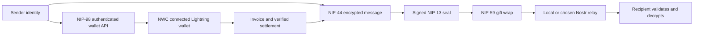

# NostrChat

Private conversations and Lightning payments in one calm workspace.

NostrChat helps freelancers, small teams, and community members keep a payment request in the same conversation as the work it concerns. A designer can discuss a task with a client, generate a Lightning invoice, share it privately, and check payment without moving between unrelated chat and payment interfaces.

## Run

From the repository root:

```sh
pnpm install
pnpm dev
```

Open `http://127.0.0.1:4405`. The shared API and local relay run on port 4400. To run only this frontend against the running API:

```sh
pnpm exec vite apps/nostrchat --config apps/nostrchat/vite.config.ts
```

The entire suite also serves the production build under `/nostrchat/`. Root documentation covers the shared server, wallet provider configuration, and production settings.

## Try the real messaging path

1. Choose **Find your people** and create a local practice identity with a display name.
2. Open Settings and copy your public key. Practice secret keys remain in tab memory.
3. Open a separate private browser window or browser profile, create a second identity, and exchange npub public keys. Both accounts use the same local relay.
4. Add the other account as a contact and send a message. A check appears only when the relay acknowledges the signed encrypted envelope.
5. Back up your practice account from Settings using a passphrase. Only the NIP-49 encrypted key is saved; unlock it after a refresh to recover relay history.

This is actual Nostr communication. The server stores signed NIP-59 gift wraps, not a plaintext imitation of a conversation. A compatible NIP-07 browser signer can replace practice identities. It must expose NIP-44 encryption and decryption.

## Try the Lightning path

1. Connect your active chat identity to the wallet API using its signed NIP-98 authorization.
2. Open the wallet drawer and provide a narrowly permissioned NWC connection. The URI is cleared from the browser after connection and encrypted by the shared server.
3. Generate a fixed-amount Lightning invoice and share it in an active conversation.
4. The payer reviews the requested amount and explicitly confirms the payment with their own connected wallet.
5. The backend verifies the wallet response. NostrChat checks that the returned preimage hashes to the invoice’s payment hash before displaying a confirmed state.
6. The payer privately shares the payment proof. The recipient checks the proof against the original invoice and can independently ask the receiving wallet for its current status.

Without a configured compatible wallet, the app shows a connection requirement. It does not claim that a payment happened. No real sats were sent as part of frontend implementation or the pure protocol tests.

## Architecture



## Included in the MVP

- Two independent Nostr identities, npub contacts, and one-to-one NIP-17 messaging.
- Sender and recipient copies of each encrypted message, stable rumor IDs, and replay deduplication.
- Relay acknowledgements, reconnect behavior, clear offline states, and retry controls.
- NIP-07 signer support with NIP-44 capability checks.
- Temporary local practice identities with optional NIP-49 encrypted backup and restore.
- NWC connection, balance, delegated capability display, invoice generation, QR, explicit payment review, and payment verification.
- Conversation search, contact details, invoice state cards, wallet settings, and readable mobile layouts.
- Locally bundled typography and an original lightweight SVG illustration.

## Security and practical limits

Read [SECURITY.md](SECURITY.md) for the threat model. Relay acknowledgement means “published,” not “read.” Relays still see recipient tags, subscription public keys, connection addresses, and timing. This MVP does not claim metadata anonymity.

Practice keys disappear when the tab closes unless the user explicitly creates an encrypted backup. No raw secret or message plaintext is stored in localStorage. Saved contact names and public keys remain local user data. The shared server stores delegated wallet credentials and must be operated securely; it does not receive a wallet seed phrase.

Message parsing is bounded. The app validates outer and seal signatures, rumor hashes, sender/recipient binding, fixed invoice facts, and payment proofs. The lightweight BOLT11 decoder is used to display and compare invoice facts; it does not validate the invoice signature itself. The connected wallet/provider validates invoices when executing payment. A hash preimage proves settlement of that specific payment hash, not fiat exchange, delivery of work, a refund, or a contact’s real-world identity.

Message history is bounded to 200 relay envelopes per subscription and 500 encrypted envelopes in local cache. The MVP uses one configured relay shared by both participants. It does not yet perform NIP-10050 relay discovery, multi-relay redundancy, pagination, file uploads, group chat, read receipts, recurring payments, or refunds.

## Validation

Run focused protocol tests with:

```sh
pnpm exec tsx --test tests/nostrchat.test.ts
```

The tests cover authenticated sender/recipient copies, third-party exclusion, altered ciphertext, signature-cache bypass, forged rumor authors, stale rumor hashes, misaddressed messages, retry deduplication, inert paid flags, invalid preimages, malformed invoice messages, relay policy, private-key rejection, and practice-key cleanup behavior.

Root Playwright checks cover the browser path and responsive screenshots. Builder tests establish technical behavior; they are not evidence of independent user adoption.

## Impact to measure

- Time for a first-time user to send and receive an encrypted message.
- Time from invoice request to provider-confirmed payment.
- Percentage of messages acknowledged on a weak connection.
- Failed-payment recovery and duplicate-payment avoidance.
- Mobile flow completion with real local freelancers or community members.
- Weekly independent conversations leading to verified Lightning payments.

The target users and benefits are a hypothesis until independently tested. No merchant reach or adoption figures have been invented.

## Next iteration

Validate the product with five independent freelancers, add relay discovery and history pagination, improve payment reconciliation after disconnects, audit the signer/wallet permission flow, and offer a properly translated French or Hausa onboarding path.
