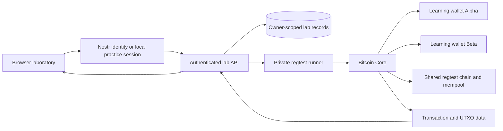

# Setup and architecture

## Complete local setup

Requirements: Linux x64, Node.js 22.12 or later in the supported 22.x line, pnpm 12.16.1, internet access for the first dependency and Bitcoin Core download, and enough disk space for the private regtest node. The Sandbox launcher provisions a dedicated Core node. Its coins have no monetary value.

From the repository root:

```bash
./start.sh sandbox
```

Open **http://127.0.0.1:4404**. The command installs the locked dependencies, provisions Core, and starts the dedicated Sandbox API and interface. Fresh-machine acceptance is recorded separately in [RELEASE.md](RELEASE.md).

The underlying development commands are:

```bash
pnpm install --frozen-lockfile
pnpm setup:sandbox
pnpm dev:sandbox
```

The setup pins the Bitcoin Core archive version and SHA-256 checksum. A checksum mismatch stops installation. The node binds RPC to loopback, runs `regtest`, and mines initial blocks for an educational funding wallet. This is local test value, not a faucet for real Bitcoin.

Sandbox setup defaults to `keypool=32` for each Core descriptor address pool, reducing initial wallet-creation work. Core replenishes these pools as needed; 32 is not a limit on the wallet's total addresses. The general Bitcoin lab keeps its default of 1000. An optional `BITCOIN_KEYPOOL_SIZE` must be a whole number between 16 and 1000.

If the dedicated Sandbox Core process is already running, setup writes the new configuration but does not restart it. Stop and restart that instance deliberately to apply the address-pool setting, retaining its existing data directory and wallets.

On an already configured machine, `pnpm dev:sandbox` starts the interface and API. Use **Continue lab** for an existing account. Reset deliberately creates another pair of wallets and preserves earned experiments and saved transaction receipts.

To build a locally served production interface:

```bash
pnpm build -- bitcoin-sandbox
pnpm exec tsx server/sandbox-local.ts
```

Open **http://127.0.0.1:4415** for this built interface; set `SATS_APP_ORIGIN=http://127.0.0.1:4415` when serving it outside the normal development origin.

For a containerized local lab:

```bash
docker compose -f compose.sandbox.yml up --build
```

The container publishes **http://127.0.0.1:4404**, uses persistent data/tool volumes, drops Linux capabilities, and runs as the Node user. It disables the local practice-account endpoint. Use a Nostr signer or the explicitly labeled temporary identity. Docker setup acceptance is tracked in [RELEASE.md](RELEASE.md).

## Services and data

| Service | Local default | Purpose |
| --- | --- | --- |
| Sandbox interface | `127.0.0.1:4404` | Laboratory, builder, explorer, and experiments |
| Dedicated Sandbox API | `127.0.0.1:4415` | Authentication, owner-scoped lab operations, and Core adapter |
| Bitcoin Core RPC | `127.0.0.1:18444` | Dedicated Sandbox regtest node; never a public browser endpoint |

Default development data lives under `.data/sandbox/`; checksum-pinned downloaded executables live under `.tools/`. Set `SATS_DATA_DIR`, `BITCOIN_RPC_PORT`, and `SANDBOX_API_PORT` before starting a custom instance. Core RPC credentials, wallet data, session material, and the SQLite database stay in the private data directory.

If ports 4404, 4415, or 18444 are already occupied, inspect the owning service before restarting. The Sandbox uses its own API and Core instance; the unrelated shared development API on port 4400 is not part of this command.

Stopping the development interface/API leaves the private Core node available for the next session. Keep its data directory to retain wallets. After a Core restart, the backend reloads only the account's known lab wallets as needed.

## Happy path to verify

1. The status panel reports **regtest** and an available Core node.
2. Create a lab. Both wallets have Core-backed funding and addresses.
3. Create a preview from Alpha to Beta for a small amount, for example **10,000 regtest sats**, with a **2 sat/vB** fee rate.
4. Check that the input total equals payment plus change plus fee. Use the actual returned fee.
5. Explicitly broadcast. Explorer shows the transaction ID with zero confirmations before mining.
6. Mine one block. Inspect a confirmation and the updated wallet outputs.
7. Reload and continue the same lab. Confirm the transaction is retained.

For the retained scripted Core check, run `pnpm verify:sandbox` against the running interface/API. It creates fresh builder-controlled identities, performs the transaction and experiment checks, and writes `docs/evidence/sandbox-regtest.json`. See [RELEASE.md](RELEASE.md) for the source hashes and accepted results.

## Recovery and troubleshooting

| Situation | What to do |
| --- | --- |
| Core unavailable | Run `pnpm setup:sandbox`, then retry the status check. |
| Wrong network | Stop. The Sandbox must reject non-regtest nodes; do not change it to mainnet to clear the error. |
| Preview expired | Create a fresh preview and review its current fee and outputs. |
| Insufficient funds | Select the funded wallet, lower the amount, or deliberately reset the no-value lab. |
| Response lost after broadcast | Check the saved operation or Explorer first. A request timeout is not evidence that nothing was sent. |
| New block changes confirmations | The runner has a shared regtest chain; another active lab can mine a block. |
| No signer | Use the labeled temporary identity, a compatible Nostr signer such as Connect, or the local-only practice session when enabled. |
| Temporary identity after reload | Its signing key lived only in memory. An existing cookie session can still work, but you cannot sign in again as that identity after the session ends. Use a recoverable signer for ongoing access. |

An uncertain broadcast freezes the original review until its saved status is checked. Reconciliation reads Core for the original transaction; it does not sign or broadcast again.

## Architecture



Local records use SQLite. The hosted implementation places authentication, preferences, progress, and verified receipts in Convex. A request-bound HMAC-authenticated private runner executes bounded Core operations and retains its SQLite protocol journal. The browser receives the reviewed transaction data and status; Core RPC credentials and PSBT signing material stay behind the runner.

The intended public route is `https://grey-finance.vercel.app/sandbox`; its deployment and acceptance are recorded in [RELEASE.md](RELEASE.md).

For the reproducible free demonstration bridge, the operator runs `node scripts/start-sandbox-hosted.mjs --configure-convex`. It ensures the separate hosted-demo Core instance is ready, creates a private HMAC key, starts the signed runner, opens a checksum-pinned Cloudflare tunnel, and configures only `SANDBOX_RUNNER_URL` and `SANDBOX_RUNNER_SECRET` in the operator's Convex deployment. Runtime metadata stays in `.data/sandbox-hosted/`.

For continuous supervision while the host is online, run:

```bash
pnpm preview:sandbox:watch
```

The supervisor probes signed regtest availability and recovers known-expired free tunnels, updating only those two Sandbox settings. It also restores a stopped private runner while keeping a healthy tunnel and the existing Core data. It requires the operator's configured Convex access and internet connection. It manages the infrastructure connection; the learner's explicit transaction review and read-only uncertain-broadcast recovery remain separate. Accepted expiry and runner-recovery checks are recorded in [RELEASE.md](RELEASE.md).

That bridge and supervisor require this computer to stay online. Sleep, shutdown, or a lost connection can make the lab unavailable. Persistent production hosting and its storage/backups remain operator responsibilities; the interface reports a runner availability error when it cannot execute a Core exercise.

## Sandbox API

The status endpoint is public. All private learner operations require the current authenticated account. The server selects its wallets; caller-supplied wallet names and ownership claims are not accepted.

| Endpoint | Purpose |
| --- | --- |
| `GET /api/sandbox/status` | Check whether the regtest runner is available |
| `POST /api/sandbox/start`, `GET /api/sandbox/state` | Create or continue the account's lab and read Core data |
| `POST /api/sandbox/preview` | Validate the sender, receiver, amount, and fee rate; create a saved transaction proposal |
| `POST /api/sandbox/broadcast` | Explicitly confirm and claim a saved preview for broadcast |
| `GET /api/sandbox/previews/:id` | Read the account's original preview and operation status |
| `POST /api/sandbox/previews/:id/reconcile` | Check an uncertain result against Core without sending another transaction |
| `POST /api/sandbox/mine` | Mine one regtest block on the runner's shared chain |
| `GET /api/sandbox/transactions/:txid` | Inspect a transaction belonging to this lab |
| `GET/PATCH /api/sandbox/preferences` | Save display name, display unit, refresh, fee-rate, and motion preferences |
| `GET /api/sandbox/progress` | Read verified experiment records and run/broadcast/mined-block counts |
| `POST /api/sandbox/experiments/:id/complete` | Verify the supplied transaction against the experiment's Core requirements |
| `GET /api/sandbox/export` | Export the learning record while excluding PSBTs and secrets |
| `POST /api/sandbox/reset` | Deliberately start a new lab; unresolved signing/broadcast outcomes block reset |

Optional display preferences change the presentation; the saved transaction always uses exact whole-sat amounts. Learning exports include at most 500 saved previews. Above that bound, the app returns an explicit export-limit error instead of silently omitting records.
