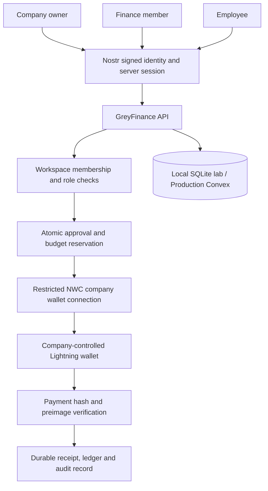

# GreyFinance

**Bitcoin treasury for teams.**

[Public app](https://grey-finance.vercel.app) · [GitHub](https://github.com/greyw0rks/grey-payroll)

GreyFinance gives a small company one place to receive Lightning payments, submit expenses, require an independent approval, enforce spending limits, and keep a verifiable payment receipt. The company controls its connected wallet; team members work through the permissions assigned to them.

The initial user is a 3–10 person African studio, startup, or distributed team that already uses Bitcoin and needs clearer control over company spending. The problem is narrow: a teammate’s invoice should become an authorized, verifiable company expense without sharing the company wallet credential with that teammate.

## Working product

- One owned company per Nostr identity, with membership in other company workspaces.
- Owner, Finance, Employee, and Viewer roles checked on the server.
- Fixed-amount Lightning invoice validation before creating a request.
- Independent approvals: requesters cannot approve or pay their own expenses.
- Company monthly budgets, per-member limits, and a maximum request size.
- Atomic reservations that survive month boundaries and ambiguous payment results.
- Explicit payment confirmation and one wallet attempt per approved request.
- Settlement verified by checking `SHA-256(preimage) = payment hash`.
- Durable payment preimage, settlement time, and source NWC account/connection fingerprint.
- Receipt proof verification in the browser, invoice QR codes, incoming payments, ledger CSV export, and workspace audit records.
- Responsive dashboard, searchable request inbox, team permissions, budgets, settings, and accessible forms.
- Owner-only company deletion with exact-name confirmation, blocked until all company and owner-wallet payment attempts have a clear result.

The internal app folder and `/api/satfamily` routes retain the initial working name. The visible product is GreyFinance. The local regtest laboratory uses SQLite; the deployed production backend is Convex, preserving the same application API and receipt fields. Deployment details and exact release evidence are recorded in [deployment notes](../DEPLOYMENT.md).

## Run locally

Use Linux x64, Node 22 and pnpm. From the repository root, this installs the dependencies, starts the private Bitcoin and Lightning wallets, and opens the product servers:

```sh
./start.sh
```

Open `http://127.0.0.1:4402/app`. The local preview is explicitly labeled. Its sample company is Baobab Studio, with Owner, Finance, and Employee personas available from the profile menu. The public product landing page is at `/`.

The repository’s shared setup starts Bitcoin Core and a two-node LND regtest lab. When that lab is running, the owner can choose **Wallet settings → Use Lightning test wallet**. These are real Lightning operations on a private Bitcoin test network. Test sats have no live Bitcoin value. Sample expense rows cannot call the wallet.

To use a company’s own wallet, leave the preview and sign in with a Nostr signer. The owner supplies a restricted NWC connection. Use provider-enforced permissions and spending limits. The preview rejects live wallet connections.

Judges without a signer can choose **Try with a temporary Nostr identity**. This creates a genuine Nostr signing key in tab memory and signs the exact HTTP request using NIP-98. It authenticates a real user and can create a real persisted workspace; it does not simulate payment or connect a wallet automatically. No plaintext key is stored or exported. Use an existing signer for ongoing company access, because the temporary identity key is lost when its tab memory is discarded.

## Verify

```sh
pnpm test
pnpm typecheck
pnpm build -- greyfinance
```

The local SQLite suite covers tenant and role isolation, invoice validation, independent approval, budgets, concurrent payments, verified preimages, uncertain-result reconciliation, preview non-spending, member removal, month boundaries, safe expiry release, and durable receipts. Release regressions cover company deletion and rollback, one-company ownership, concurrent creation, operator caps before wallet calls, legacy duplicate-owner guards after wallet awaits, account changes on the same NWC service, late payment responses, and signed temporary login events without browser key storage. `pnpm test` also runs the shared wallet HTTP and Convex production-backend suites.

The earlier `docs/evidence/satfamily-regtest.json` remains historical SQLite test-network transaction evidence with a service-key reference. The new [public-domain payment evidence](../evidence/greyfinance-personal-convex-regtest.json) verifies current Convex settlement and connection fingerprints. Both records identify their network, timestamps and source hashes; neither establishes independent adoption.

Local deletion and current public-domain browser checks can be reproduced with:

```sh
pnpm exec tsx docs/satfamily/verify-deletion-ui.ts
pnpm exec tsx docs/satfamily/verify-hosted-company-ui.ts
```

These scripts use an existing Playwright Chromium installation, or `SATS_CHROMIUM_PATH`, and record desktop and 390px/360px phone views. The local deletion check needs the local servers. The hosted check creates and deletes disposable companies through real signed login without connecting wallets or requesting payments. Optional `GREY_RELEASE_COMMIT` and `GREY_PRODUCTION_DEPLOYMENT` label a known tested release; omit them when the exact revision is unknown. The earlier local captures remain as historical records.

## Architecture



The owner’s receiving/spending connection is resolved on the server. The MVP allows one owned company per Nostr identity; the same identity can join other companies as a member. Finance receives permission to trigger an approved application operation, not the delegated wallet credential. Live tenants cannot fall back to the shared local test treasury. Employees see their own expenses and allowance; company incoming records, treasury balance, and other members’ spending limits are withheld. Production persistence belongs to the dedicated Convex implementation; the SQLite suite and local Lightning proof validate the isolated laboratory implementation.

## Constraints

- Team approvals are application controls. They are not cryptographic multisignature or protection against a server operator who holds the delegated spending credential.
- Spending budgets count invoice amounts. Routing fees remain controlled by the wallet/provider and are not included in the current budget ledger.
- The server operator’s per-payment cap applies before any company wallet call or payment claim. Its configuration must be a positive safe integer; invalid configuration disables spending.
- An unclear payment stays reserved and cannot be paid again. Reconciliation must use the original NWC wallet identity and matching settlement proof.
- Expiry releases only a pending or approved invoice that has never entered the payment attempt state. It never releases an uncertain or in-progress payment merely because an invoice has expired.
- The database audit record is useful operational history, not an immutable public ledger.
- Company deletion removes that company's memberships, requests, incoming receipts and audit records, and disconnects the stored owner wallet connection. Export needed records first. The Nostr identity, sessions, other company memberships and personal wallet payment history remain. Deletion neither moves funds nor revokes provider permissions or cancels provider invoices.
- NWC operations require a valid account/connection fingerprint using `SHA-256("nwc:" + servicePubkey + ":" + clientPubkey)`. This distinguishes connections that share a wallet service. The fingerprint is retained alongside the payment hash and preimage; other providers without a connection fingerprint are identified as unavailable.
- Wallet binding is per authenticated owner. The MVP enforces one owned company per Nostr identity. Treasury operations for legacy accounts with several owned companies are blocked until distinct company wallet bindings are supported; existing records are preserved.
- Local builder demonstrations establish functional proof. Mainnet operation, independent team adoption, and a production security audit are separate milestones.

## Local impact and next iteration

Pilot with five Nigerian/Senegalese teams of 3–10 members. A planning target is ten expense requests per team per week, or 50 requests weekly; this is an estimate, not measured adoption.

Track request-to-approval time, approval-to-settlement time, verified payments, blocked policy violations, reconciliation delays, and successful completion on a mid-range phone. Interview each owner and finance reviewer about their existing workflow before claiming time saved.

Next: support multiple owned companies with distinct wallet bindings, add account recovery and wallet rotation procedures, support structured invoice replacement/cancellation, include routing-fee accounting, and conduct an independent security review before wider live use.

The [three-minute demo script](./DEMO.md) and [security notes](./SECURITY.md) accompany the product. Visual direction is documented in [DESIGN.md](../../apps/satfamily/DESIGN.md).
