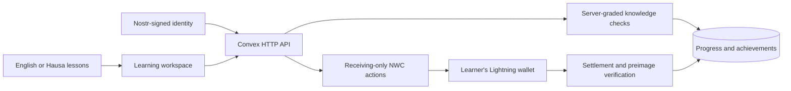

# SatsAcademy

Learn Bitcoin by doing one small, verifiable thing at a time.

SatsAcademy is an open-source learning space for beginners in Nigeria and West Africa. Three short quests teach Bitcoin units, wallet safety, and Lightning payment states in English and Hausa. A separate wallet lab lets a learner connect a restricted NWC wallet, create a 10-sat invoice, and earn Lightning Explorer only after the receiving wallet supplies matching settlement proof.

## Product

- A public landing page and a searchable learning path.
- Three complete lessons with interactive diagrams and server-graded knowledge checks.
- Signed Nostr identity authentication, optional temporary identity, and a saved learner profile.
- Persistent progress, knowledge achievements, and a separately verified wallet achievement.
- A receiving-only Lightning wallet lab with invoice QR, network, expiry, permission review, status checks, and receipt history.
- A course guide grounded in the lesson material. AI responses are identified only when an AI provider is configured.
- English and Hausa preferences, paginated full receipt export, and a lesson reset that retains verified payment evidence.
- Horizontal desktop navigation and safe-area-aware phone navigation.

The learning wallet uses its own academy connection, separate from the GreyFinance company treasury. No payment-send operation is exposed by the academy.

## Run locally

From the repository root, run the complete private regtest setup and academy:

```bash
./start.sh academy
```

The launcher installs dependencies, starts Bitcoin Core and two LND regtest wallets, and opens the academy. It requires Linux x64, Node.js 22.12+ and pnpm. If the lab and dependencies are already available, use `pnpm dev -- academy`.

Open `http://127.0.0.1:4403`. The launcher starts the shared local API if needed. Read lessons without signing in, or use a Nostr signer to save progress. The temporary-identity option signs an actual Nostr authentication event; its key stays only in tab memory and cannot be restored after it is lost.

For a no-value wallet exercise, follow the repository's Bitcoin Core and LND regtest setup. The local wallet shortcut appears only when the local demo and Lightning lab are both available. It connects the receiving Alice wallet; pay its invoice from Bob on the same private network.

A configured external NWC wallet also works. The receiving exercise requires `make_invoice` and `lookup_invoice`. Balance access is optional. Grant only the permissions needed, keep any spending permission capped at the wallet provider, and revoke the connection there when finished.

## Routes and hosting

The release packages this product at `/academy/` and the learning workspace at `/academy/app` on the existing GreyFinance domain. Lesson, wallet, achievement, guide, and profile routes support direct navigation and browser history. Same-origin API requests are routed to Convex in production. Predictable local preview sessions are disabled there.

The academy stores durable profiles, quiz attempts, progress, achievements, wallet connections, and exercises in Convex. Wallet requests run server-side through established NWC libraries. The local service has equivalent scoped routes for development and the private regtest lab.



## How the exercise proves a skill

1. Sign in with a Nostr identity.
2. Connect a restricted academy learning wallet.
3. Create a fresh 10-sat receiving invoice.
4. Pay it using a second wallet on the same network.
5. Select **Check payment status**.
6. The server checks the invoice owner, source wallet, network, amount, settled state, and payment preimage/hash.
7. Only a matching verified settlement creates the practical achievement and receipt.

A quiz answer, screenshot, pending invoice, or browser callback cannot award Lightning Explorer.

## Learning records

**Download learning record** pages through every wallet exercise receipt before creating one JSON file. It also includes the profile, lessons, achievements, and latest 100 quiz attempts. The export excludes delegated credentials, session keys, invoice requests, and payment preimages.

**Reset lessons** clears quiz attempts, lesson progress, and knowledge badges after exact confirmation. Verified payment receipts, Lightning Explorer, the wallet connection, and the current session are retained.

## Limits and next iteration

Hausa content is an initial translation awaiting independent native-speaker review. Reading times are estimates. Independent learner adoption and local impact are not yet measured. Regtest coins have no monetary value; a successful regtest exercise is protocol evidence rather than mainnet settlement.

The next iteration should test the complete flow with at least five independent learners, review Hausa with native speakers, and improve mobile signer compatibility. French follows content validation. There are no cash rewards or investment recommendations.

Track lesson completion, time to a first verified invoice, wallet connection failures, successful retries, and learner feedback on Hausa clarity. Builder tests are kept separate from independent learner measurements.

The final release passed 339 automated tests and 57 browser checks at 360, 390, 1024 and 1440 pixels, including sign-in, persistent progress, keyboard focus, initial Hausa content, and two explicitly simulated network failures. See [release verification](../evidence/academy-release-checks.json) and [the final browser report](visual-review/2026-11-16T11-50-27-742Z/verification.json).

See [security and constraints](SECURITY.md), [the three-minute demo](DEMO.md), and [the design contract](../../apps/satsacademy/DESIGN.md).
